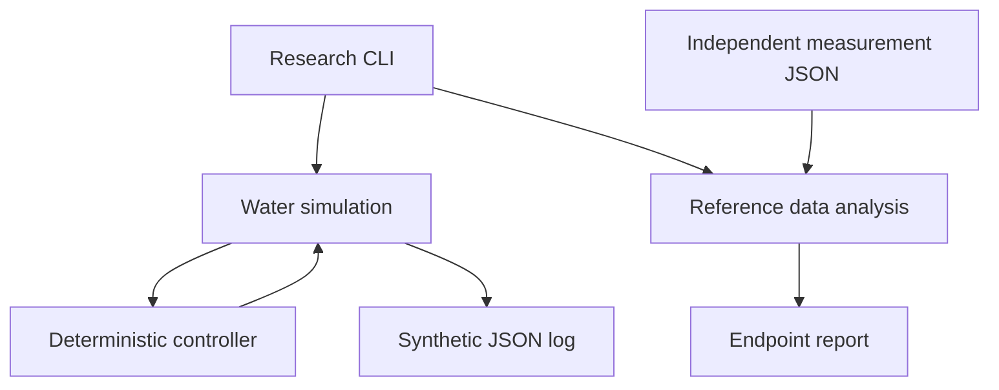

# Software architecture

The controller consumes one fresh control reading and produces an abstract heat or cool request. Faults and completion latch. Dwell resets after a band excursion. Missing load, unavailable mixing, invalid/stale/nonadvancing measurements, clock problems, temperature limits and timeouts disable simulated actuation.

The simulation integrates a lumped water model at one second intervals. Heating, cooling, ambient loss and input electricity are explicit assumptions. It omits sensor dynamics, vessel heat capacity, refrigerant behavior, stratification and food chemistry. Its constants are not fitted or validated.

Analysis operates on three independent reference channels with a full 60-second window. It guard-bands temperature error by an externally established expanded uncertainty. Data provenance is an explicit field, not proof of authenticity. A human reviewer must verify source, calibration, placement and custody. No runtime module turns software output into physical actuation.

Future physical architecture needs an independently implemented safety layer, reviewed IO and bounded control authority. A learned model may inform convenience features but must not bypass deterministic protections. Hardware watchdogs, electrical isolation and thermal cutoffs cannot be replaced by Python exception handling.
