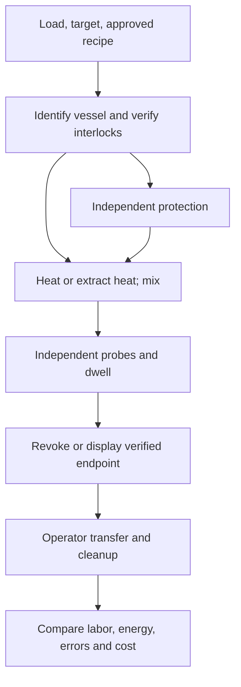

# THERMA COMMONS engineering verification and redesign

November 23, 2026 · Decision basis for the next feasibility tranche

**Verdict — [GATE-FUND - RE-ARCHITECT FIRST].** The current package establishes a concept and runnable research software. Its integrated appliance, commercial performance, field reliability, safety case and certification remain untested. Two-way heating and cooling is already sold at commercial scale. The narrower thesis is a measurable reduction in operator handling for one small-volume workflow with independently verified endpoints. A field unit is a separately funded procurement option.

## 1. Causal topology and interface contracts



An actuator can move energy, an independent measurement can support an endpoint claim, and only the operator comparison can support the commercial claim. The safety cutout can interrupt delivery independently of the software. Log valid and failed cycles. A field seal, a firmware signature and a green light answer different questions.

| Boundary | Required contract and worst-case mismatch | Causal sever or check |
|---|---|---|
| Operator → recipe → vessel | Supported mass, fill, geometry, stirring and initial temperature must be declared. A viscous, stratified or wrong-volume load can leave the verification envelope even when power is available. | Reject the envelope mismatch. Start with a single water load and logged starting conditions. |
| Supply → heat and cooling plant | At the agreed ambient and supply limits, net extraction must remain positive and exceed energy inventory divided by the cycle budget. A circulator's nominal rating does not include hoses, a jacket, approach temperature or untreated heat soak. | Measure net extraction and electrical demand at the vessel. On power loss, revoke verdict and require deliberate reset. |
| Plant → vessel → sensing | For a 360 s end-to-end target including 60 s dwell, the simplified 46,840 J inventory needs 46,840 / 300 = 156.1 W net. An undersized loop, poor thermal contact or a stalled mixer breaks that contract. | Measure vessel/wall gradients, characterize contact and evaluate the hottest ambient separately. |
| Control channel → independent reference | Real sensing needs its own acquisition, timebase/checks, calibration trace, and an uncertainty budget. Shared connectors, offsets, sampling clocks or power can defeat apparent redundancy. | Inject disconnected, implausible and stale conditions in a supervised test. Readiness falls when either channel is invalid. |
| Hardwired protection → energy isolation | Electrical protection, independent high/low limits, fail-closed behavior, fluid containment and safe restart need product validation. A stuck relay or lost controller defeats software-only isolation. | Review de-energization and residual stored energy separately. Require fault isolation at the dock and independent confirmation before reuse. |
| Verification → HMI → workflow | A fresh, one-second interval sequence must satisfy a bounded band and dwell; fault or excursion clears the current indication. False reassurance can survive as operator habit after a true status is revoked. | Distinguish **Verified endpoint**, **Not verified** and **Out of service** through text and accessible cues. No safety or sanitation claim. |
| Field enclosure → dock → module | Transport restraint protects a cold, empty, de-energized vessel. After impact, qualified inspection is required before powering or inserting a duty module. | Do not keep the compressor and vessel on the same carried mass path. Post-impact leak, insulation and calibration checks are separate from visual inspection. |
| Repeated workflow → buyer value | Workflow results need a matched, current comparator and observed staff time. At low use, cleaning and standby can eat all savings. | Log active handling, failed cycles and cleaning. Record consumables, labor and the budget owner. |

Hidden confounders include operator learning and sequence effects, residual heat from the preceding trial, room temperature, staff multitasking, fill variation, probe placement, and selection of an inferior comparator. Randomize order inside operator/day blocks, return each arm to an agreed initial condition and log deviations before seeing outcomes. The real cooling interface should use a vendor map and installed-load measurements, with an envelope based on ambient and heat-rejection conditions.

### Proposed architecture

- **Common local verification dock.** Separate washable, replaceable vessel; pluggable heating and cooling service modules; independent protective cutout; and a physically separate reference path. Local readout and removable, provenance-checked log export. No network, cloud account, wireless control, foundation model, or remotely accepted sensor input in the thermal control or verification path.
- **Commercial version.** Begin with a tethered, supervised bench comparison using existing equipment. Promote only the best-fit small-volume workflow to a cleanable single appliance if the measured workflow delta justifies integration. Keep heating and cooling mutually exclusive with independent resource limits. Compare a chilled-loop configuration against an appropriate incumbent, including ice bath or existing refrigeration where the operator actually uses it.
- **Rugged field option.** Use a cold, empty, non-energized removable vessel in a transport carrier and a separately handled dock; use mains or facility-approved shore power. Treat drop resistance as rough handling survivability, tested on inert surrogates and then under a lab-approved qualification plan. No active refrigerator, energized module, liquid, or stored electrical energy in the impact specimen. A dropped operating unit is quarantined. No field shock or ingress rating is claimed. Test cooldown and recovery, connector damage, strain relief, wash-down boundary, cable trip exposure and heat rejection before any listed field duty.
- **Security and service.** Hardwired safety is independent of the trust anchor. Carry signed firmware with a known-good, authorized offline recovery image, local version verification, rollback policy and timebase checks. Record control and safety authority separately. Use tamper-evident calibration history and witnessed reference checks after service. Model simultaneous common causes such as loss of supply or a shared acquisition path before counting channels as independent.
- **Supply.** Qualify an alternate for each critical module by origin and tier, keep approved local service stock, and maintain a nonpowered alternate service procedure. A missing compressor, suitable refrigerant or controller stops production of the affected configuration. Passive ice-assisted cooling is a separate, externally supplied workflow with its own suitability limits.

## 2. Sixty-day falsification plan

**Registered hypothesis.** In the selected workflow, for a fixed 500 g water load and a 20 °C transition in each direction, a modular verified workflow reduces median hands-on time by at least 20% compared with the site's best available equivalent workflow while preserving verified endpoint quality and avoiding an unacceptable elapsed-time or energy penalty. This is one precise thesis to reject. Passing on water does not validate viscosity, food safety, electrical safety, or field hardware.

[ASSUMPTION: trial settings = 40→60 °C and 60→40 °C, 12 independent operator/day blocks per direction, three reference locations, 1 Hz acquisition, 60 s complete dwell, absolute endpoint error plus expanded uncertainty ≤1.0 °C at all measured locations, reference spread plus expanded uncertainty of the difference ≤1.0 °C, reference expanded uncertainty target ≤0.2 °C | frozen engineering hypotheses and host-scale water workflow; thresholds require metrology and operator sign-off | Confidence: Low]

[ASSUMPTION: comparator guardrails = median elapsed time and attributable wall energy each ≤1.10× incumbent, with absolute idle and cleaning costs logged; two eligible pilot reviewers; $0 founder cash with qualified host resources | commercial decision criteria, not quoted price or statistical evidence | Confidence: Low]

1. **By day 10**, confirm one host, two operator reviewers, meters and independently calibrated references. Include the real power/ice/cleanup boundary. If ice or utility energy cannot be compared on equivalent terms, mark the energy gate unresolved. An absent host is an execution stop.
2. **By day 20**, select the incumbent with the operator and freeze order randomization, sample positions, uncertainty arithmetic, exclusion rules, operator timing and stop rules. Separately tune the bench. Do not use tuning runs for final inference.
3. **By day 50**, record 24 paired trials (12 per direction, two arms per pair, 48 runs), one pair per direction per independent block where possible. Record every failure, note ambient and time of day, blind the clock adjudication and balance arm order. For each pair, calculate D = 0.8 × incumbent hands-on seconds − candidate hands-on seconds. Positive D meets the handling threshold. If blocks are dependent, use independent blocks or report the inference as unresolved. Ties are not counted as evidence against the threshold.
4. **By day 60**, reject the threshold in either registered direction if at least 10 of 12 non-tied block results have strictly negative D. Under a boundary null with a 0.5 negative-sign probability, one-sided p = (66 + 12 + 1) / 2¹² = 0.01929, or a two-direction Bonferroni upper bound of 0.03858 for that rejection threshold. Fewer than 12 valid non-tied values do not meet this specific rule. Release no next-stage money on inconclusive results. A confirmed false verified endpoint or unsafe energy delivery stops the configuration immediately, pending investigation and redesign. Positive handling evidence, conformity against every preregistered quality rule, guardrails and buyer interest are separate release conditions. These 24 pairs do not substantiate a low field-failure rate.
5. If the selected workflow survives, separate the existing 60-run mass/transition feasibility campaign from the buyer comparison. Test field environmental and safety hardware only after scope, host, professional review and funding.

## 3. Adaptive ecosystem and reality matrix

| Regime | Main shock and likely 18-month adaptation | Survival conditions and unit economics |
|---|---|---|
| Alpha · Commercial | Incumbents bundle comparable cook/chill or probe features, cut dealer prices, or make switching nearly free. A 100× burst overwhelms trained service and line capacity. | Use data showing handling savings, standard vessel sizes and service obligations. At assumed 83 units/month against 150 units/month available, 100× for one month creates about 8,150 units of backlog if orders are taken, before cancellations. Rate-limit orders and qualify a second build route before accepting volume. |
| Beta · Disrupted field / governed procurement | Power and connectivity fail independently. Damaged lines, electromagnetic disturbance, invalid identities and tampered measurements can deny service. Buyers demand configuration provenance and an agreed compliance scope. | Local verified operation survives only with intact approved power, sensing and hardware. Power failure means service loss; approved fallback runs separately. Assumed field economics are negative even at P99. Require a paid requirement-owning sponsor or stop the field tranche. |
| Gamma · Autarky | Tooling, refrigerant, compressor or MCU availability changes despite apparently separate distributor names. A true total replacement embargo hits installed maintenance and ends further production after stock is exhausted. | Local operation has zero runtime cloud/API dependence. Qualify alternates by true manufacturer and origin, with a finite stock allowance and a no-production state when supply fails. Gamma draws model surviving supply, not unrestricted output after stockout. |
| Delta · Cognitive and integrity collapse | Crews optimize READY rate, suppress faults, substitute vessels or skip cleaning. A malicious or mistaken insider compromises calibration history or reference integrity. A counterfeit part can defeat dual-channel logic. | Track invalid attempts and failure-free verified handoffs per opportunity, inspect a sample of records, design explicit fault text, require authorized resets, and protect both measurement and service paths. Do not reward overrides. |

[ASSUMPTION: burst example = demand 83 units/month, capacity 150/month and one month at 100× | round operating scenario, with baseline close to modeled 1,000 units/year | Confidence: Low]

Game logic: an incumbent will copy when incremental retained margin exceeds engineering and channel costs. An operator will bypass when immediate delay exceeds the expected personal cost of bypass. A buyer will switch only when independent labor and rework savings exceed cleaning, training, capital and service burdens. State or non-state disruption changes availability and data credibility, while the same local controls address nonmalicious faults. Make safety outcomes independent of operator incentives, and make procurement economics depend on reproducible evidence and a repair agreement instead of a proprietary software subscription.

**Compliance scope.** The FDA Food Code is a model a jurisdiction may adopt. Its cooked time/temperature-control-for-safety cooling example is 135→70 °F within 2 h and 135→41 °F within 6 h total. Water at 40–60 °C cannot demonstrate that process. Have a lab and the local authority scope NSF/ANSI 4 or 7 and the applicable electrical certification route for the chosen product category. For field options use rough-handling guidance as a test reference, not a certification claim. A standalone food appliance with local logs does not acquire a FedRAMP High cloud authorization requirement solely from federal sale. HIPAA depends on covered activities and data. FDA device status depends on intended use. Export jurisdiction is classification-specific. Apply CMMC only to the procurement and information boundary as required by its actual clauses. Map any ISO standard to a concrete customer/site requirement and budget it separately. A medical, controlled export, cloud or classified requirement triggers a new scope and cost model. See references below.

## 4. Quantitative engine

**Status.** The Python engine ran 20,000 pseudo-random trials per regime using seed 20261123. It independently samples bounded Uniform economic and cooling inputs. Bounds are stress brackets, not measured distributions. Conditional success rates are fixed knobs, so sensitivity is conditional on them. Cash flow omits residual value, taxes, leverage and changing year-by-year ramps. Each percentile is marginal. For cooling time and energy, the numerically high side is adverse. No percentile represents an observed outcome or a guaranteed worst case.

### 1 · Readiness and sovereignty

[ASSUMPTION: TRL=2, IRL=2, MRL=2, RSL=2 | concept and offline research artifacts; no measured integrated apparatus, qualified supply chain, formal regulatory determination or production line | Confidence: Med]

On the requested 1–9/1–10 scales, TRL follows NASA concept-stage guidance. IRL and RSL are local rubric scores, with 1 as requirement only, 2 as proposed architecture, 3 as standalone bench evidence, and higher scores reserved for evidenced integration, independent replication and field use. MRL 2 is a conceptual production path. **CDR = (2 × 2 × 2 / 729) × (2 / 10) = 0.00219.** This is a score, not a success probability. The separate field packaging also lacks a built prototype.

### 2 · Physical ceilings and energy boundary

[ASSUMPTION: water heat capacity = 4,184 J/(kg·K) | NIST liquid-water heat capacity rounded at room temperature | Confidence: High]

[ASSUMPTION: load = 0.5 kg, ΔT = 20 K, coupled vessel/loop capacitance = 250 J/K, nominal heater input = 300 W, useful heat-transfer fraction = .85, incidental heating loss = 15 W, simultaneous auxiliary load = 20 W, dwell = 60 s, evaporator = 283.15 K, condenser = 328.15 K | sizing inputs for a small bench, with no installed map or duty measurements | Confidence: Low]

- Water heat = 0.5 × 4,184 × 20 = **41.84 kJ** each way. With 250 × 20 = 5.00 kJ of coupled inventory, transported heat = **46.84 kJ**. Heating net = 300×.85−15 = 240 W, yielding (46,840/240)+60 = **255.2 s**. At 160 W net cooling, (46,840/160)+60 = **352.8 s**. Model the heat rejected to the room as Q_hot = Q_cold + compressor work. At 160/1.8 = 88.9 W compressor work during pull-down, the idealized rejection path handles **248.9 W** before auxiliary or external loads.
- Refrigerator Carnot limit at assumed working temperatures = 283.15/(328.15−283.15) = **6.292 COP**. At the Alpha midpoint COP 1.8, η = 1.8/6.292 = **0.286**. The simulated Alpha P99 η is 0.442. No modeled value trips the >0.75 flag. A hypothetical COP >4.719 at the same temperatures would trigger **[PHYSICAL ANOMALY]** under the requested rule. This is a review flag, distinct from violating Carnot at η>1. Vendor nominal 200 W at +20 °C is a real bath specification and provides no guaranteed net delivered rate at this vessel.
- Wall service yield = useful heat moved both ways / modeled electric energy. Heat leg = 300×195.17 + 20×255.17 = 63,653 J. Cool leg = 46,840/1.8 + 20×352.75 ≈ 33,077 J. Total ≈96.73 kJ = **26.87 Wh**, yield **83.68/96.73 = 0.865**. This credits warming and cooling as separate thermal services. No energy is generated. Fixed-loss logistics, consumables and idle/cleaning/defrost are outside the measured boundary and must be included for lifecycle yield, which remains unestimated. A modeled extra 10 Wh per paired cycle makes the yield 83.68/(96.73+36) = **0.630**. There is no training or inference stage. At 1 Hz, the Nyquist limit is 0.5 Hz for band-limited signals. A complete one-second sample sequence certifies the discrete abstraction alone, and very brief excursions need separate analog or faster independent protections.

[ASSUMPTION: expanded overhead example = 10 Wh per paired cycle | sensitivity example for idle and cleaning allocation, with no field data | Confidence: Low]

### 3 · Global sensitivity

[ASSUMPTION: independent Uniform ranges below for annual sales conditional on success, margin after variable warranty/service/fulfillment, present-valued program TCO, net vessel cooling W, cooling COP | post-concept decision brackets; vendor bath ratings anchor scale, market and cost ranges require quotations and buyer confirmation | Confidence: Low]

[ASSUMPTION: per-regime success triples below = P(tech), P(regulatory | tech), P(adoption | tech, regulatory) | illustrative conditional scenario weights, no calibration data | Confidence: Low]

| Regime | Units/year | Margin/unit | TCO | Conditional success triple | Net cooling | COP |
|---|---:|---:|---:|---|---:|---:|
| Alpha | 200–1,800 | $100–500 | $100–150k | .70/.85/.65 | 90–230 W | .8–2.8 |
| Beta | 60–700 | $100–420 | $145–245k | .60/.65/.55 | 45–175 W | .65–2.15 |
| Gamma | 40–550 | $40–300 | $100–210k | .55/.80/.50 | 25–155 W | .5–1.9 |
| Delta | 100–1,100 | $60–380 | $110–170k | .55/.80/.50 | 60–200 W | .7–2.5 |

For Y = kUM−C, k is risk weights × discounted annuity. For independent U, M, C, Var(Y) = k²[Var(U)E(M)² + Var(M)E(U)² + Var(U)Var(M)] + Var(C). Uniform Var(X) = (b−a)²/12. Alpha's variance terms use E(U)=1,000, E(M)=300, Var(U)=213,333.33, Var(M)=13,333.33, Var(C)=208,333,333.33 and k=.883037. Shares = **53.86% volume, 37.41% margin, 7.98% interaction, 0.75% cost**. The first two explain **91.27%** of variance. P99−P1 is a spread, not a variance decomposition. Beta's largest driver is program cost (47.56%) followed by volume (31.59%). Gamma is dominated by cost (76.34%). Delta volume/margin explain 44.79%/34.11%.

At Alpha midpoints, Net ROI = (.883037×1,000×$300−$125,000)/$125,000 = **111.93%**. At 800 units it is **69.54%** and at 1,200 units **154.31%**, a swing of about ±42.39 percentage points. This midpoint-input sensitivity differs from the Monte Carlo median ROI of 81.89%.

### 4 · NPV and capital flexibility

[ASSUMPTION: r = 15%, years = 3, flat end-year conditional contribution, no terminal value | high-risk planning hurdle and short commercialization window, not a cost-of-capital quote | Confidence: Low]

A = 1/1.15 + 1/1.15² + 1/1.15³ = **2.283225**. Alpha rNPV at the midpoint is $(1,000×300×2.283225×.70×.85×.65)−125,000 ≈ **$139,911**. The break-even midpoint is $125,000/(.883037×$300) ≈ **472 units/year**. Beta break-even is $195,000/(.489752×$260) ≈ **1,531 units/year**, outside the sampled volume band. Beta at 380 units/year would need ~$1,048 of margin per unit or an economically equivalent reduction in required project cost.

| Regime | rNPV P1 / P50 / P99 | Cooling s P1 / P50 / P99 | Wall Wh P1 / P50 / P99 |
|---|---:|---:|---:|
| Alpha | −$97,602 / $101,028 / $580,526 | 265 / 354 / 572 | 24.0 / 27.0 / 35.7 |
| Beta | −$227,205 / −$148,461 / −$43,353 | 330 / 486 / 1,074 | 25.9 / 30.2 / 40.8 |
| Gamma | −$199,322 / −$129,723 / −$48,357 | 365 / 576 / 1,827 | 26.9 / 32.8 / 48.4 |
| Delta | −$152,134 / −$82,269 / $50,877 | 296 / 420 / 822 | 24.8 / 28.5 / 38.6 |

Alpha P99 / |P1| = $580,526/$97,602 = **5.95×** under the percentile convention. P1 is a downside proxy, not a maximum drawdown. Using full modeled at-risk capital of $150,000 and zero proceeds yields **3.87×**, below 4. Beta and Gamma have zero positive simulated P99 upside. Delta = $50,877/$152,134 = **0.33×**. Favor gating even in Alpha.

[ASSUMPTION: ungated commitment = $150,000 committed up front through Month 18; Month-6 sponsor gate cap = $25,000 with no cross-default or committed downstream minimums; all amounts are incremental scenario dollars | $25,000 earlier feasibility ask and illustrative full-program commitment ceiling | Confidence: Low]

Month-6 abandonment preserves **$150,000−$25,000=$125,000** of uncommitted cash (83.3%) and avoids **18−6=12 months** of further program exposure. It does not recoup six elapsed months or release obligations that were signed early. Test the water-only comparison earlier, by day 60, and use Month 6 to close the evidence and commercial decision.

### 5 · Reliability, dual failures and recovery

[ASSUMPTION: per-session dependency A=[.98 site supply, .97 thermal module, .99 vessel/mixer, .995 controller, .995 verification, .98 operator workflow]; independence for baseline only | illustrative screening, not observed failure rates | Confidence: Low]

Serial reliability = .98×.97×.99×.995×.995×.98 = **0.91307 per session**. Correlated outages can make this estimate optimistic. The two dominant functional dependencies are thermal module and independent verification because either removes the combined capability. If both are unavailable, **N−2 verified capability = 0 / 1 = 0%**. A deliberately available alternate manual workflow can provide some service separately. Safe shutdown is a safety objective, not a verified-output substitute. Require independent cutout plus a default-off energy path and separate reference validation. A true common-mode defect can defeat both, so actual residual safety must be tested.

[ASSUMPTION: detectable fault recovery = 10 min to detect/confirm plus 20 min to restore, service deadline = 60 min | emergency provisioning planning scenario; measure under exercises | Confidence: Low]

Recovery/collapse = (10+20)/60 = **0.50**, missing the strict <0.50 threshold. Design target ≤20 min total gives ≤0.33. A hazardous heat or electrical fault can require immediately acting hardware protection; the service-horizon ratio does not apply to hazard containment.

### 6 · Temporal half-life and drift

[ASSUMPTION: remaining feature-only advantage at 18 months = .35, and initial equipment NRE/CapEx basis = $125,000 with annual calibration $4,000, firmware maintenance $4,000 and supplier requalification $7,000 | existing integrated incumbents and illustrative service budget, pending quotes | Confidence: Low]

Assume E(t)/E(0)=exp(−λt). λ=−ln(.35)/18=.05832/month, so t½=ln(2)/λ≈**11.9 months**. With a half-life of 6 or 24 months, 18-month retention would be 12.5% or 59.5%. The quoted half-life is a scenario. Annual drift tax = ($4k+$4k+$7k)/$125k = **12.0%**. If modeled as incremental recurring cost, its expected-PV effect at Alpha's full-success weight is $15k×2.283225×.38675 ≈ $13,246. The primary model treats routine service in contribution or TCO; deduct the additional drift only if truly incremental.

### 7 · Field hardening penalty

[ASSUMPTION: comparable commercial/field program capital basis = $125,000/$195,000 with $25k rugged/mechanical validation, $20k firmware provenance and recovery, $15k environmental/EMC evaluation, $10k spare-provisioning and documentation; schedules = 12 and 18 months | workstream placeholders and current unquoted midpoints; authority-specific scopes excluded | Confidence: Low]

Capital multiplier = ($125k+$70k)/$125k = **1.56×**. Schedule dilation = 18−12 = **+6 months**. For cooling-limited equal-size serial cycles, median throughput tax = 1−353.6146/486.4886 = **27.31%**, around 10.18 versus 7.40 cycles/hour, excluding handling. The capex multiplier uses the modeled program cost as a capital proxy; funding, cost allocation and CapEx accounting need quotes. The field model excludes medical, cloud authorization and any export-controlled procurement. The schedule of 18 months plus a potential lab or procurement delay does not establish a date commitment.

### 8 · Weakest assumption

[ASSUMPTION: a specialist small-batch appliance can sustain commercial volume and $300 contribution per sale after the incumbent response | feasibility thesis only, with adjacent bidirectional incumbents already shipping | Confidence: Low]

The weakest assumption is that a measurable handling benefit converts to durable paid demand at that margin. Cheaper probes, existing connected equipment, or incumbent workflow bundles can make a technically sound product redundant. The economic distributions have no real demand or price calibration. Collect blinded paired performance plus buyer-level willingness-to-pay evidence before updating either prior. Recompute with correlated volume, margin, and supply shocks once field samples or actual proposals support them.

## 5. Executive scorecard

[ASSUMPTION: six-axis scores below | engineering judgment using 0 for absent evidence and 10 for validated repeated deployment under scope | Confidence: Low]

| Axis | Score / 10 | Reason |
|---|---:|---|
| Causal, compositional and physical verifiability | 6.0 | Energy can be measured and readiness logic can be enumerated. Integrated hardware data are absent. |
| Regime Beta resilience | 3.0 | Offline safeguards are plausible. Power, heat rejection, shock and certification remain unqualified. |
| Sovereignty and supply-chain autarky | 3.0 | No cloud runtime dependence. Cooling modules, materials and electronics still have upstream dependencies. |
| Financial convexity and real options | 5.5 | Cash can be gated. The full-loss commercial convexity fails 4×. |
| N−2 resilience and cascade resistance | 2.5 | Verified operation goes to zero after loss of both dominant dependencies. |
| Temporal half-life and defensibility | 3.5 | Existing competitors are relevant. Defensibility would come from a measured workflow advantage and service. |

**SOVEREIGN VERDICT — [GATE-FUND - RE-ARCHITECT FIRST].**

**Dominant lever — make the independent verification dock the shared product boundary and contractually fund everything beyond it in opt-in tranches.** A separately powered protection path and a readiness gate remove the modeled *single-input* false-ready path. The $25k hard commitment cap removes the modeled early full-program cash lock-in if terms actually prohibit forward commitments. Physical common-mode faults and actual cash recoverability remain open.

[ASSUMPTION: modular design retains 90% of the commercial P99 benefit before cost, and both modeled comparisons hold TCO at $125,000 | interface reuse scenario with equal cost basis, no customer data | Confidence: Low]

At equal fixed cost, net upside retention = [0.90×($580,526+$125,000)−$125,000]/$580,526 = **87.85% modeled**, and the $125,000/150,000 avoided exposure is **83.3%**. Break-even gross benefit retention for an 85% net result is about **87.66%**. These targets justify a gated test and contract structure. Neither the catastrophic-risk reduction in physical service nor the P99 retention is established empirically.

## Reproducing the research

```sh
PYTHONPATH=src python -m unittest discover -s tests -v
PYTHONPATH=src python -m therma_commons.verification --seed 20261123 --output local-results/verification.json
```

The synthetic checker visits 62 reachable abstract states and exhausts 31,744 (state × sensor evidence × reset) transitions. Its one-second interval booleans assume truthful evidence and independent protective authority. It does not prove physical temperatures, clock integrity, EMC, hardware safety or Byzantine fault tolerance. The legacy simulator retains its original single-channel dwell semantics. Its completion latch cannot serve as the physical READY indication. GitHub Actions independently runs the suite and writes a date-seeded report without modifying the repository or connecting to test equipment.

## References

- [NIST Chemistry WebBook, water heat capacity](https://webbook.nist.gov/cgi/cbook.cgi?ID=C7732185&Table=on&Type=JANAFL) and [NIST refrigerator thermodynamics](https://tsapps.nist.gov/publication/get_pdf.cfm?pub_id=50016)
- [PolyScience nominal cooling specifications](https://www.polyscience.com/products/circulating-baths/refrigeratedheated-circulating-baths/refrigerated-circulator-7-liter-ad-20-c) and [IRINOX MultiFresh Next cooking and chilling functions](https://www.irinoxprofessional.com/en_ww/products/blast-chillers/multifresh-next)
- [California Energy Wise equipment testing](https://caenergywise.com/testing/) and [NASA technology readiness levels](https://esto.nasa.gov/trl/)
- [FDA Food Code](https://www.fda.gov/food/fda-food-code/food-code-2022) and [2024 supplement](https://www.fda.gov/food/fda-updates-food/fda-releases-supplement-2022-food-code)
- [NSF food equipment standards](https://www.nsf.org/nsf-standards/standards-portfolio/food-equipment-standards), [OSHA NRTL FAQ](https://www.osha.gov/nationally-recognized-testing-laboratory-program/frequently-asked-questions), and [IEC rough handling](https://webstore.iec.ch/en/publication/516)
- [NIST SP 800-193 firmware resilience](https://doi.org/10.6028/NIST.SP.800-193), [FedRAMP scope](https://www.fedramp.gov/scope/), [HHS covered entities](https://www.hhs.gov/hipaa/for-professionals/covered-entities/index.html), [FDA medical device intended use](https://www.fda.gov/medical-devices/classify-your-medical-device/how-determine-if-your-product-medical-device), [BIS jurisdiction](https://www.bis.gov/licensing/determine-what-is-subject-to-the-EAR), and [DFARS procurement clauses](https://www.acquisition.gov/dfars/part-204-administrative-and-information-matters)
- [GitHub scheduled workflow behavior](https://docs.github.com/en/actions/reference/workflows-and-actions/events-that-trigger-workflows#schedule)
